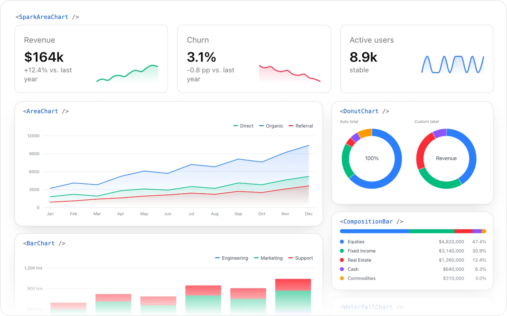
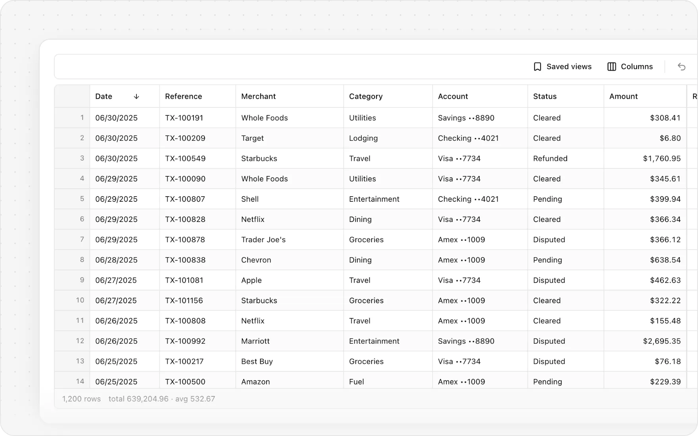
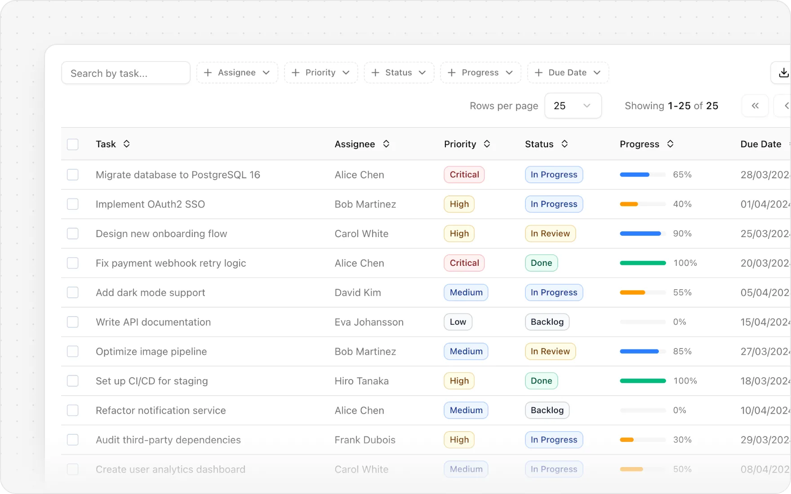
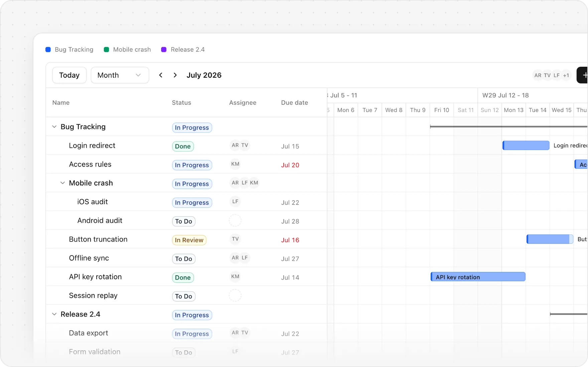
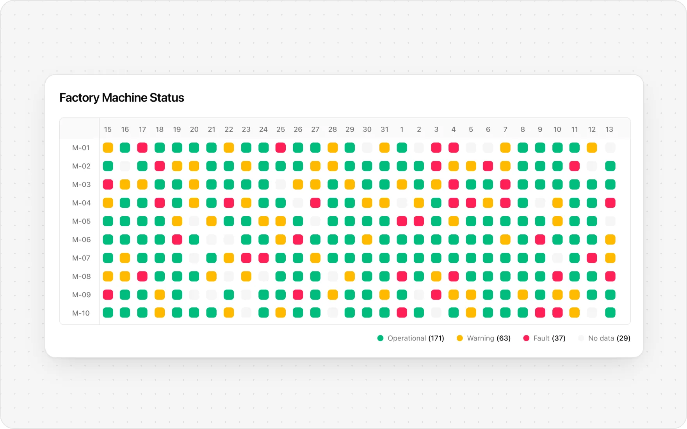
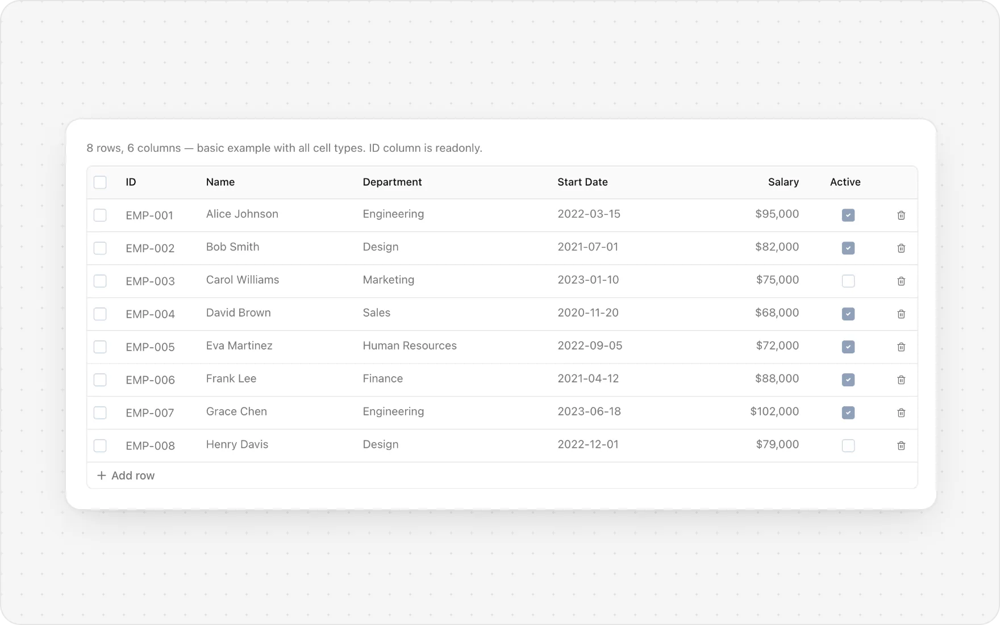
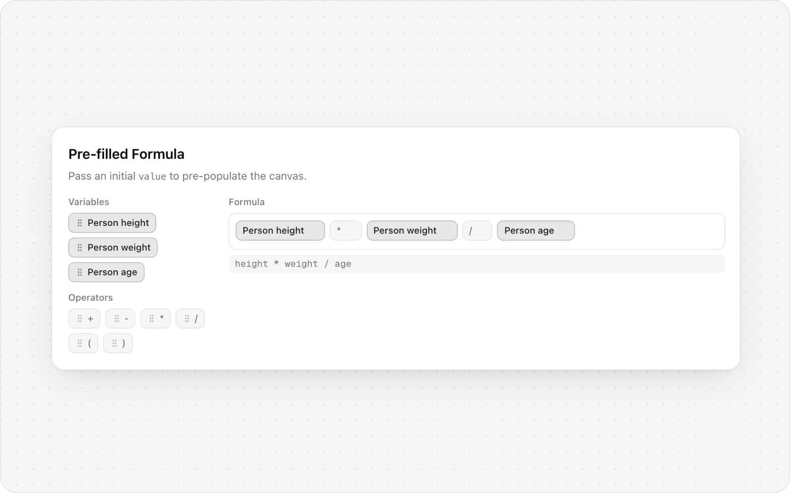
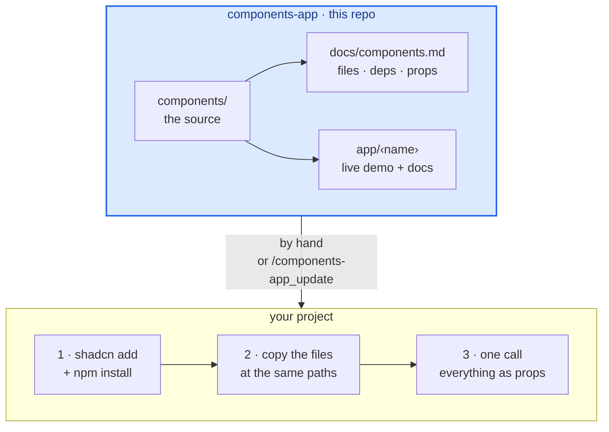

<div align="center">

<picture>
  <source media="(prefers-color-scheme: dark)" srcset="docs/assets/logo-dark.svg">
  
</picture>

**Reusable React components for building cool dashboards. Copy, paste, ship.**

[](https://components.pbrenner.com)
[](#catalog)
[](#how-it-works)
<br>


</div>

<picture>
  <source media="(prefers-color-scheme: dark)" srcset="docs/assets/hero-dark.webp">
  
</picture>

## Why

<table>
  <tr>
    <td align="center" width="25%"><h2>21</h2>components, from data grids to date pickers</td>
    <td align="center" width="25%"><h2>7</h2>charts, light and dark from the same tokens</td>
    <td align="center" width="25%"><h2>1</h2>JSX call per component, all props</td>
    <td align="center" width="25%"><h2>0</h2>packages to install from here</td>
  </tr>
</table>

Dashboards keep needing the same pieces: a grid that survives a million rows, a chart that looks right in dark
mode, a date picker that speaks Portuguese. This is where those pieces live, built on **shadcn/ui, Tailwind v4
and Radix**. Nothing is published to npm: a component is **copied into the project that needs it**, shadcn-style,
so the code is yours and no version pins you down. Every one has a live demo and its docs at
[components.pbrenner.com](https://components.pbrenner.com).

## Screens

<table>
  <tr>
    <td width="50%">
      <picture>
        <source media="(prefers-color-scheme: dark)" srcset="docs/assets/data-grid-dark.webp">
        
      </picture>
      <a href="https://components.pbrenner.com/data-grid"><b>DataGrid</b></a>: virtualized, Excel-style filters, frozen columns, undo/redo, CSV/XLSX
    </td>
    <td width="50%">
      <picture>
        <source media="(prefers-color-scheme: dark)" srcset="docs/assets/data-table-dark.webp">
        
      </picture>
      <a href="https://components.pbrenner.com/data-table"><b>DataTable</b></a>: sorting, filters, pagination, bulk edit, drag-to-reorder columns
    </td>
  </tr>
  <tr>
    <td width="50%">
      <picture>
        <source media="(prefers-color-scheme: dark)" srcset="docs/assets/gantt-dark.webp">
        
      </picture>
      <a href="https://components.pbrenner.com/gantt"><b>Gantt</b></a>: a tree and a timeline, groups rolled up, scales from hours to years
    </td>
    <td width="50%">
      <picture>
        <source media="(prefers-color-scheme: dark)" srcset="docs/assets/status-map-dark.webp">
        
      </picture>
      <a href="https://components.pbrenner.com/status-map"><b>StatusMap</b></a>: rows × dates, every cell coloured by its status
    </td>
  </tr>
  <tr>
    <td width="50%">
      <picture>
        <source media="(prefers-color-scheme: dark)" srcset="docs/assets/editable-grid-dark.webp">
        
      </picture>
      <a href="https://components.pbrenner.com/editable-grid"><b>EditableGrid</b></a>: typed cells, keyboard navigation, per-cell validation
    </td>
    <td width="50%">
      <picture>
        <source media="(prefers-color-scheme: dark)" srcset="docs/assets/formula-builder-dark.webp">
        
      </picture>
      <a href="https://components.pbrenner.com/formula-builder"><b>FormulaBuilder</b></a>: drag variables and operators into an expression
    </td>
  </tr>
</table>

## Catalog

| Group | Components |
|---|---|
| **Rich** | [DataTable](https://components.pbrenner.com/data-table) · [DataTable v2](https://components.pbrenner.com/data-table-v2) · [DataGrid](https://components.pbrenner.com/data-grid) · [EditableGrid](https://components.pbrenner.com/editable-grid) · [Gantt](https://components.pbrenner.com/gantt) · [FormulaBuilder](https://components.pbrenner.com/formula-builder) |
| **Charts** | [AreaChart](https://components.pbrenner.com/charts/area-chart) · [BarChart](https://components.pbrenner.com/charts/bar-chart) · [DonutChart](https://components.pbrenner.com/charts/donut-chart) · [SparkAreaChart](https://components.pbrenner.com/charts/spark-area-chart) · [WaterfallChart](https://components.pbrenner.com/charts/waterfall-chart) · [CompositionBar](https://components.pbrenner.com/charts/composition-bar) · [ProgressBar](https://components.pbrenner.com/charts/progress-bar) · [StatusMap](https://components.pbrenner.com/status-map) |
| **UI** | [Tabs](https://components.pbrenner.com/ui/tabs) · [Badge](https://components.pbrenner.com/ui/badge) · [Select](https://components.pbrenner.com/ui/select) · [MultiSelect](https://components.pbrenner.com/multi-select) · [DatePicker](https://components.pbrenner.com/date-picker) · [MonthPicker](https://components.pbrenner.com/month-picker) · [Card](https://components.pbrenner.com/ui/card) |

Each one has an entry in [docs/components.md](docs/components.md) with the files to copy, its shadcn and npm
dependencies, a usage example and the props.

## How it works



Every component is a **single call driven by props**: no providers, no `<Table.Row>` sub-components, no setup
outside the JSX.

```tsx
<DataTable<Row>
  columns={createColumns<Row>()}
  columnsMetadata={columnsMetadata}
  data={data}
  enablePagination
  bordered
/>
```

Colours come from tokens (`bg-muted`, `border-border`), so light and dark come free, and chart series take their
colours from one palette (`chartColors`) that a fork swaps in one place.

> [!TIP]
> **Copying with an AI agent?** Point it at [docs/components.md](docs/components.md): it opens with a
> step-by-step protocol for copying or updating a component with no wasted steps. In Claude Code, the
> [`/components-app_update`](.claude/commands/components-app_update.md) command runs it (copy it to
> `~/.claude/commands/` to use it from any project).

## Quickstart

```bash
npm install   # .npmrc sets legacy-peer-deps (Atlaskit DnD vs React 19)
npm run dev   # http://localhost:3000
```

<details>
<summary><b>Copy a component into your project</b></summary>

The target needs a shadcn/ui setup with `lib/utils.ts` (`cn()`). Then, from the component's entry in
[docs/components.md](docs/components.md):

```bash
npx shadcn@latest add button input popover   # 1. its shadcn primitives
npm install @tanstack/react-virtual          # 2. its npm packages (Atlaskit ones need --legacy-peer-deps)
                                             # 3. copy its files to the same paths, index.ts included
```

Charts also need `components/charts/utils/` once per project (`chartColors`, `chartHelpers`,
`MeasuredResponsiveContainer`, `useOnWindowResize`).

</details>

<details>
<summary><b>Scripts</b></summary>

| Script | What it does |
|---|---|
| `npm run dev` | Dev server |
| `npm run build` | Production build |
| `npm run start` | Serves the build |
| `npm run lint` | ESLint |

</details>

<details>
<summary><b>Adding a component</b></summary>

- Source in `components/ui/<name>/` (charts: `components/charts/<name>/`), with an `index.ts` barrel.
- Demo at `app/<name>/page.tsx` (charts: `app/charts/<name>/page.tsx`), with a `<ComponentDoc>` block under it.
- An entry in `lib/components-registry.ts`, or the home page won't list it.
- An entry in [docs/components.md](docs/components.md), from the template at its top, and the [catalog](#catalog) above.

The full conventions are in [CLAUDE.md](CLAUDE.md).

</details>

## Docs

- [docs/components.md](docs/components.md): every component's files, dependencies, usage, props and notes
- [CLAUDE.md](CLAUDE.md): conventions for components, charts and demo pages

<div align="center">
<sub>
Made by <a href="https://x.com/pablobrenner_">@pablobrenner_</a> ·
<a href="https://components.pbrenner.com">components.pbrenner.com</a>
</sub>
</div>
